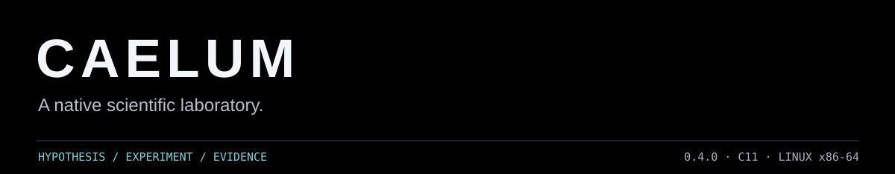
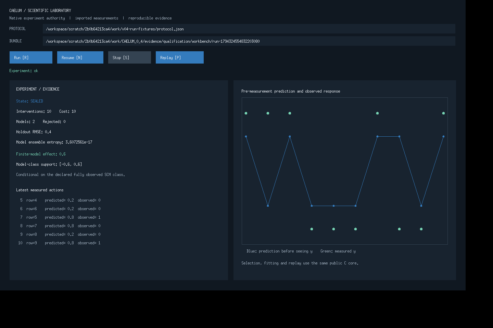
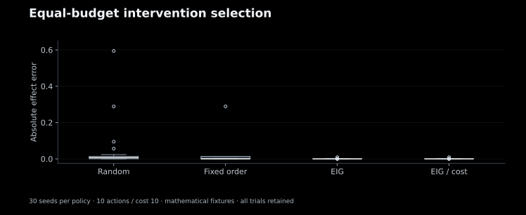
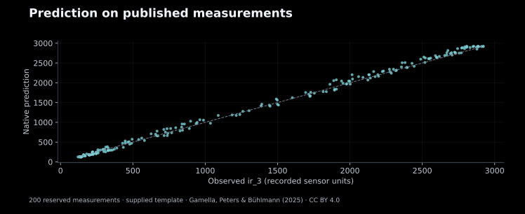
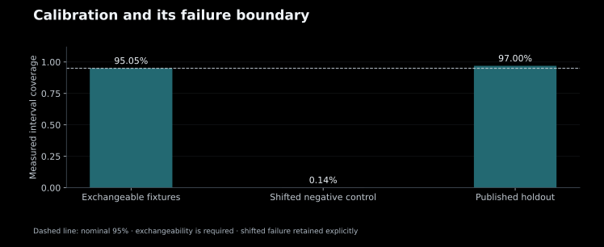

<strong>0.4.0 · C11 · C ABI 1.3 · Linux x86-64</strong> By Alexandru Moraru · Apache-2.0

CAELUM is a native scientific laboratory for testing competing mathematical models against measured data. It connects model selection, permitted intervention planning, uncertainty, falsification and deterministic replay through one experiment authority. Its command line, desktop workbench and C SDK share the same first-party scientific core.

[Download & release assets](docs/DISTRIBUTION.md) · [Scientific methods](docs/SCIENCE.md) · [Validation](docs/AUDIT.md) · [C API](docs/API.md) · [Cite](CITATION.cff)

## Use CAELUM

Download **`CAELUM-0.4.0-linux-x86_64-app.zip`** from this repository's Releases. Extract it and launch `Start-CAELUM.sh`. An X11 display is required. The included example is a labelled mathematical fixture; your experiments supply their own measurement files and assumptions.

**Run** starts a new experiment, **Stop** completes the current atomic step, **Resume** continues its checkpoint, and **Replay** recomputes from frozen inputs and captured randomness. The [complete research volume](docs/DISTRIBUTION.md) is a separate download containing source, SDK, tests and evidence.

View the actual native workbench

## Scientific core

| Area | Implemented scope |
|---|---|
| Learning | Conditioned QR, augmented-QR ridge, weighted-QR Huber and bounded sparse-polynomial discovery |
| Experimental design | Imported measurements, explicit controls and budgets; random, fixed-order, disagreement and finite information-gain policies |
| Causality | Fully observed binary SCMs, bounded PC-Stable estimation and model-class-conditional interventional inference |
| Meaning | Variable roles, finite domains, seven-axis units, typed expression DAGs and analytic gradients |
| Uncertainty | Finite-model weights and unfalsified-model support; independent split-conformal calibration |
| Dynamics | Chronological holdout, implicit midpoint, component-scaled forward/reverse/repeat checks |
| Exchange | Stable capsule, restricted ONNX Gemm, Arrow C Data, CPU float64 DLPack and affine scikit-learn bridge |
| Evidence | Immutable input snapshots, versioned receipts, captured seed provenance, source/build identities and checkpoint replay |

## Recorded results

The graphs below are generated from the checked-in CSV/JSON results. All trials, including losses and negative controls, remain in the evidence.

Thirty seeds, four policies, ten actions and equal cost per run. EIG had lower effect error than random selection in **29 of 30** trials and higher error in one. The equal-cost control makes EIG/cost identical to EIG. These are bounded mathematical-test results, not a universal superiority claim.

The published-data evaluation uses **1,000 original Causal Chambers measurements** with a fixed 600/200/200 training/calibration/holdout split. Three templates were declared before analysis; training BIC selected the displayed template. Held-out RMSE was **60.05 in the recorded sensor units**, with **97% measured interval coverage**. Native and independent NumPy predictions differed by less than 6e-12. These are the dataset authors' existing measurements; no chamber was operated here.

## Verification

| Executed check | Recorded result |
|---|---|
| GCC Debug, GCC optimized, Clang ASan/UBSan | 18 native targets in each profile |
| Clean extraction and relocation | **54/54 packaged native targets passed** |
| Public ABI | 71 declarations, 71 definitions |
| Static analysis | 23 translation units, zero diagnostics |
| File commits and snapshots | 80 failure/recovery trials; 1,000 concurrent snapshot checks |
| Independent numerical/causal study | 626 numerical/calibration assertions; 9,300 finite-SCM checks; 120 active runs |
| Scoped formal checks | Eleven UNSAT obligations, one SAT negative control, and bounded actual-C Philox safety verification |

Full memory checks, native UI lifecycle checks, corruption tests, numerical comparisons, losing trials and prior failures are documented in [the audit](docs/AUDIT.md). The current evidence is **Linux x86-64** qualification. Windows/macOS native execution remains unqualified. New GitHub workflow runs are separate from the recorded local results; no unexecuted CI badge is presented as a test result.

## Repository and releases

| Path | Contents |
|---|---|
| `src/`, `include/`, `adapters/` | One current scientific implementation and public SDK |
| `native/` | Qualified Linux application and installed SDK |
| `tests/`, `verification/` | Executable contracts, independent oracles, proofs and matching test profiles |
| `fixtures/`, `cases/`, `evidence/` | Labelled inputs, current outputs, provenance and audit history |
| `docs/` | Methods, formats, API reference and simple source-backed graphs |
| `.github/workflows/` | Native CI and owner-triggered draft release preparation |

The [complete file tree](TREE.md) and [release status](RELEASE_STATUS.json) describe the full volume. Application release assets exclude the GitHub presentation and research archives. The packaging process preserves the qualified scientific binaries and their source/build identity.

## License and citation

First-party CAELUM is licensed under [Apache-2.0](LICENSE), permitting commercial and noncommercial reuse under its terms. Third-party tools, the citation schema and published data retain their own licenses; see [NOTICE](NOTICE.md) and the [component license map](docs/LICENSE_SCOPE.md).

Use [CITATION.cff](CITATION.cff) to cite the software. When using the physical-measurement data, also cite Gamella, Peters and Bühlmann, *Causal chambers as a real-world physical testbed for AI methodology* (2025), [DOI: 10.1038/s42256-024-00964-x](https://doi.org/10.1038/s42256-024-00964-x).

CAELUM's prediction and numerical-reversal results do not establish causal truth, physical reversibility or certified hardware entropy. Active runs consume imported interventions; arbitrary ONNX graphs, FMI, latent-confounder identification and Experiments B/C are outside this release. [Exact scientific scope](docs/SCIENCE.md) · [Exact formal scope](docs/FORMAL_SCOPE.md).

This product includes software developed by Daniel Kroening, Edmund Clarke, Computer Science Department, University of Oxford, Computer Science Department, Carnegie Mellon University; the full research volume contains the separately licensed CBMC verifier.
